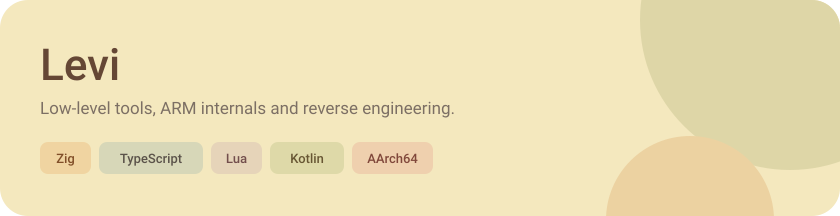
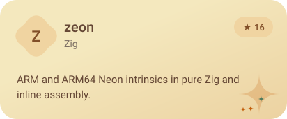
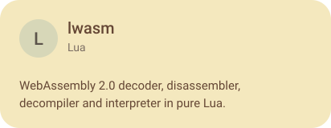
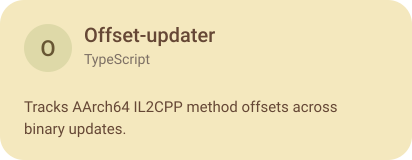
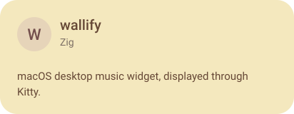
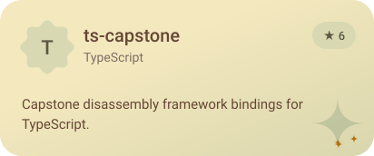
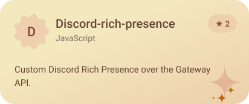
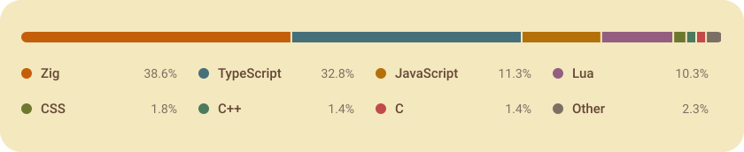

<picture><source media="(prefers-color-scheme: dark)" srcset="assets/banner-dark.svg"></picture>

  <a href="https://n0thhhing.github.io"><picture><source media="(prefers-color-scheme: dark)" srcset="assets/link-website-dark.svg"></picture></a>
  <a href="https://github.com/n0thhhing?tab=repositories"><picture><source media="(prefers-color-scheme: dark)" srcset="assets/link-github-dark.svg"></picture></a>
  <a href="https://instagram.com/levi.napz"><picture><source media="(prefers-color-scheme: dark)" srcset="assets/link-instagram-dark.svg"></picture></a>

### Projects

  <a href="https://github.com/n0thhhing/zeon"><picture><source media="(prefers-color-scheme: dark)" srcset="assets/project-zeon-dark.svg"></picture></a>
  <a href="https://github.com/n0thhhing/lwasm"><picture><source media="(prefers-color-scheme: dark)" srcset="assets/project-lwasm-dark.svg"></picture></a>

  <a href="https://github.com/n0thhhing/Offset-updater"><picture><source media="(prefers-color-scheme: dark)" srcset="assets/project-offset-updater-dark.svg"></picture></a>
  <a href="https://github.com/n0thhhing/wallify"><picture><source media="(prefers-color-scheme: dark)" srcset="assets/project-wallify-dark.svg"></picture></a>

  <a href="https://github.com/n0thhhing/ts-capstone"><picture><source media="(prefers-color-scheme: dark)" srcset="assets/project-ts-capstone-dark.svg"></picture></a>
  <a href="https://github.com/n0thhhing/Discord-rich-presence"><picture><source media="(prefers-color-scheme: dark)" srcset="assets/project-discord-rich-presence-dark.svg"></picture></a>

### Languages

<picture><source media="(prefers-color-scheme: dark)" srcset="assets/languages-dark.svg"></picture>

